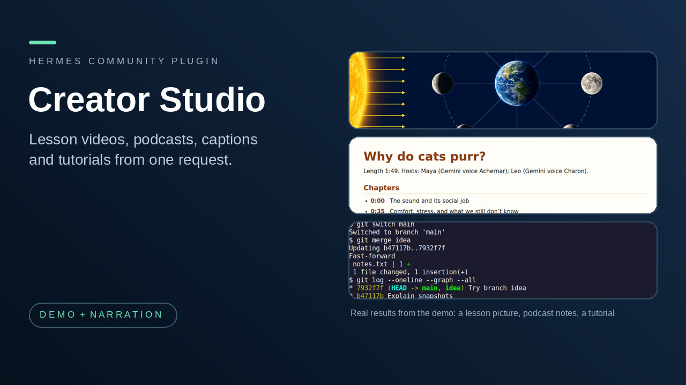

# Creator Studio



Make media with Hermes from one request: researched lesson videos, two-host podcast episodes, captions for any recording, and narrated step-by-step tutorials.

**At a glance**

- **Who it is for:** people who make explainer videos, podcasts, captioned recordings or software tutorials and want Hermes to do the research, scripting, narration and assembly while they review the result.
- **Install:** `hermes plugins install flabanabba8/creator-studio`, then `hermes plugins enable creator-studio`, then restart Hermes.
- **Needs:** Hermes 0.22.3 or later and FFmpeg. Python Pillow is installed from the manifest. Speech, pictures and speech recognition come from tools you choose (see each part below). Linux is the only platform checked.
- **Internet:** nothing happens by itself. Research pages are fetched only through tools you select. Gemini narration, if you choose it, sends narration text to Google (Vertex AI) using a Google sign-in that Hermes holds for your own OAuth client, behind a spending guard. An HTTP speech recognizer, if you choose one, receives audio you confirm. Nothing is uploaded or published.
- **Limits:** quality depends on the speech, image and recognizer tools you pick; always listen to and look at the result before sharing. Windows and macOS are untested. The tutorial recorder captures X11 or XWayland windows only.
- **Credits:** see [Credits and licences](#credits-and-licences). Licence: GPL-3.0-or-later.
- **AI assistance:** written with AI coding assistants (Anthropic Claude and OpenAI Codex agents) under the maintainer's direction; what was actually tested is listed in [VERIFICATION.md](VERIFICATION.md).

**0.4.0:** narration asks the user which voice to use and never picks one. The speech setup tools list what this computer has, read the hardware and suggest online services (Gemini 3.8 Flash TTS, Inworld, ElevenLabs, with dated free-allowance facts) and local models that fit; the saved choice is the only route used. New Gemini API-key route (no Cloud project needed) and `system` engine. See `llmwiki/speech-models.md` and VERIFICATION.md.

## What the suite does

Creator Studio bundles four plugins that research, script, narrate, caption or record media. They keep their own tool names, rules and skills; installing one entry gives you all of them.

| Part | What it is for | Skill | Tools |
|---|---|---|---|
| **YouTube Studio** | Research a topic, draw charts, tables, flowcharts and slides, and assemble a narrated, captioned lesson video from sources and pictures you select. Makes the file; does not upload it. | `create-youtube-video` | 19, `youtube_*` |
| **Podcast Studio** | Research a topic, write a source-backed two-host script, check that the editorial review covers the current text, record each host in its own voice and mix optional music. Makes show notes, captions and a transcript. | `create-podcast` | 22, `podcast_*` |
| **Caption Studio** | Create timed captions from a recording with a recognizer you choose, listen and review words and timing, and repair or retime an existing subtitle file. Originals are never overwritten. | `repair-captions` | 13, `captions_*` |
| **Tutorial Creator** | Record one selected X11 window, mark the steps, optionally drive the window through Hermes `computer_use`, narrate and export a checked tutorial video under 90 seconds. | `create-tutorial` | 10, `capture_*` and `tutorial_*` |

Total: 64 tools, 4 skills, no hooks, no middleware, no slash commands. Caption Studio also brings a Desktop page. There is no web dashboard tab; the API route serves the Desktop caption page.

### Across the parts (new in 0.2.0)

- **"Add captions to that video / episode / tutorial."** Say it in plain words, no file names. `captions_for_latest` finds the newest finished item the suite made. A podcast episode or narrated tutorial already has captions from its own script, so those come back first (nothing is recognized); a video gets script captions from its narration timing. Speech recognition runs only if you ask for it, or for media that has no script. No burned-in copy is made.
- **"Make a podcast episode from that lesson."** `podcast_start_from_video` starts a podcast project from a finished lesson's saved sources and notes. The source ids and addresses stay the same and are marked as copied from the lesson; nothing is fetched from the web again, and you go straight to reading them locally and writing the script.

- **Carry on.** A stopped or failed run resumes from the project: `youtube_project_status` and `podcast_project_status` (no id) list projects with their next step, `capture_status` (no id) does the same for recordings, and speech already recorded is never paid for twice. A lesson video also says plainly if a chart or flowchart was made but left out.

### Why these four together

All four research, script, narrate, caption or record media. YouTube Studio and Podcast Studio overlap and already shared the same speech code (`gemini_speech.py`, the Gemini 3.8 Flash TTS route), so the suite carries that code once, in `common/`, together with the file lock and the page reader they also shared. Caption Studio can caption audio that any of the other parts produces, and Tutorial Creator is the screen-recording counterpart of the video parts. The Tutorial Creator keeps its own speech code because it supports more narration backends.

## Install and enable

```
hermes plugins install flabanabba8/creator-studio
hermes plugins enable creator-studio
```

Restart Hermes (or start a new session) afterwards. If you also have one of the stand-alone plugins (`youtube-video-studio`, `podcast-studio`, `caption-studio`, `automatic-tutorial-creator`) enabled, disable it first: the tool names are the same, so run only one of the two.

## What it needs, part by part

- **All parts:** Hermes 0.22.3 or later, FFmpeg and ffprobe, Python (Pillow is installed from the manifest).
- **YouTube Studio:** pictures from a native image tool you select in Hermes (optional; slides, charts, tables and flowcharts are drawn locally without one); speech from Gemini 3.8 Flash TTS with a Google sign-in held by Hermes (your own OAuth client, `hermes auth add creator-studio:google`, and the `gemini_project` setting) or from a speech server already running on your computer. Page research can use an installed Camoufox browser, otherwise use your Hermes web tools.
- **Podcast Studio:** speech through Gemini 3.8 Flash TTS (a Google sign-in held by Hermes); FFmpeg for mixing; music files you have rights to use; optional installed Camoufox for page research.
- **Caption Studio:** a speech recognizer you choose: a local command, word-timestamp JSON from an existing recognizer, an HTTP speech service, or an existing host speech tool. The optional API key (`CAPTION_STUDIO_ASR_KEY`) is a secret setting stored by Hermes and used only when you select it.
- **Tutorial Creator:** a Linux X11 or XWayland desktop, `xwininfo`, `xprop`, `xdotool`, `pactl` and `xclip` for the matching features, and FFmpeg. Narration through Gemini (default), a loopback speech server you run (including the Higgs TTS3 route), or a speech tool you select.

## What it calls on the internet

- Public web pages, when you ask a research or source tool to read them (YouTube Studio and Podcast Studio), through the Camoufox browser you selected. Public addresses only; no browser download.
- `aiplatform.googleapis.com` (Google Vertex AI), only when you choose Gemini narration, using your own Google login and project, behind a per-project or per-tutorial spend guard (default 0.50 USD; each request is reserved in proportion to its text, and a refusal states the estimate and what to raise).
- A speech recognizer you select in Caption Studio: local commands send nothing; an HTTP recognizer receives audio only after your explicit consent for that run.
- Loopback ports on your own computer: YouTube Studio probes ports 8000, 8001, 8080, 5000, 8880 and 7860 on 127.0.0.1 to find a speech server; Tutorial Creator can talk to a loopback speech server you configure.
- No telemetry, no update checks, no self-updater. Updates reach you only through a new pinned version of this plugin.

## Google sign-in for Gemini narration (changed in 0.3.0)

Gemini narration is optional. The plugin no longer reads the `gcloud` login or any other tool's credential file,
and it never sees or refreshes a Google token: Hermes holds the sign-in and attaches it to each speech request
(catalog rule 11). One-time setup:

1. In your own Google Cloud project, enable the Vertex AI API and create an OAuth client of type "Desktop app"
   (APIs & Services, Credentials).
2. Add the client to this Hermes profile's `.env` as `CREATOR_STUDIO_GOOGLE_CLIENT_ID` and
   `CREATOR_STUDIO_GOOGLE_CLIENT_SECRET`.
3. Set the plugin setting `gemini_project` to that project's id.
4. In a terminal: `hermes auth add creator-studio:google`. Your browser opens Google's consent page for the
   `cloud-platform` scope; the token is sent only to `aiplatform.googleapis.com`.

`hermes auth status creator-studio:google` shows the sign-in and `hermes auth logout creator-studio:google` removes it.
Without the sign-in, a Gemini request is refused before anything is sent and the message names the command above;
the other speech routes are unaffected. Needs Hermes 0.22.3 or later.

## Where your files go

Each part keeps its working files in its own folder under your Hermes profile's `plugin-data` directory (mode 0600/0700): `creator-studio-youtube`, `creator-studio-podcast`, `creator-studio-captions`, `creator-studio-tutorial`. These are new folders. Data written earlier by the stand-alone plugins (`youtube-video-studio`, `podcast-studio`, `caption-repair`, `automatic-tutorial-creator`) is not migrated and not touched; copy a project folder across yourself if you want to continue it. The reason for separate folders is that the parts' own path checks (profile-media opt-ins, project lookups) assume exactly one data folder per part, and a shared folder would let parts see each other's projects and private caption reviews. Show notes, captions and transcripts can also be copied into an ordinary folder you name.

## What each part runs

FFmpeg and ffprobe (all media parts); one subprocess with the Python of a Camoufox install you select, to read a public page; recognizer commands you configure (Caption Studio; it refuses to start `codex`, `claude`, `gemini` or `hermes`); `nvidia-smi` for GPU memory and Python import probes when you ask Caption Studio for recognizer options; `xwininfo`, `xprop`, `xdotool windowraise`, `pactl` and `xclip` (Tutorial Creator). A detached FFmpeg recording worker runs from `capture_start` until `capture_stop` or its time limit; one analysis thread per Caption Studio audio review. `tutorial_step` clicks and types in the recorded window by calling Hermes's own `computer_use` tool, so Hermes's approval rules apply to every action. Nothing runs outside a task you started.

## Known limits

- Linux is the only platform checked. Windows file-locking was checked with synthetic media for the video and podcast parts only; no real Windows run.
- No part can verify that sources are true, that a recognizer heard correctly, or that a voice reads a script correctly. Listen and look before you publish.
- Gemini narration is tested against mocked transports in the unit tests; real runs are recorded in each part's own verification file.
- The Desktop page belongs to Caption Studio only. It reaches the plugin through a small API route (`dashboard/plugin_api.py`); the dashboard tab itself is hidden because no web page exists.
- Quality, licence and cost of speech, music and pictures depend on the services and files you select.
- Because the suite shares one speech module between YouTube Studio and Podcast Studio, a change to Gemini routing affects both.
- No thumbnail or demo media is bundled yet.

## Credits and licences

- Licence of this plugin: GPL-3.0-or-later (see LICENSE). Other applications and codecs keep their own licences.
- Narration voices come from the engine you choose (Gemini 3.8 Flash TTS from Google, a local speech server, or a host speech tool); that engine's terms apply, and music or pictures you add must be ones you have rights to use.
- Tutorial Creator, Higgs route: the Higgs TTS 3 model is licensed separately from this plugin's code. The published model's Creator Use Grant permits qualifying creator content with Boson attribution; other uses may require a separate licence. Every narrated export writes the credit next to the video for its description. See the [model card and licence](https://huggingface.co/bosonai/higgs-tts-3-4b). No reference clips are shipped.
- YouTube Studio follows [YouTube's current chapter instructions](https://support.google.com/youtube/answer/9884579); correct formatting does not guarantee channel or video eligibility. It does not access YouTube or publish.
- YouTube Studio and Podcast Studio draw on the Breach Protocol listener-first editorial and timed-production practices, generalized to any show and cast, without its characters or assets.
- Page research can use the [Camoufox](https://github.com/daijro/camoufox) browser if you have installed it; nothing is downloaded by the plugin.
- Caption Studio was formerly named Caption Repair. The recognizers you pick bring their own terms.
- This plugin is not affiliated with or endorsed by YouTube, Google or Nous Research. The other credits in the original part READMEs (kept in each part's folder) are carried over unchanged.

## Layout and the original READMEs

```
creator-studio/
  plugin.yaml  __init__.py  README.md  VERIFICATION.md  LICENSE
  common/            Gemini speech, file lock and page reader shared by YouTube and Podcast Studio
  youtube_studio/    the part's code, tests, skill and llmwiki, plus its original README and VERIFICATION
  podcast_studio/    same for Podcast Studio
  caption_studio/    same for Caption Studio
  tutorial_creator/  same for Tutorial Creator
  desktop/ dashboard/   Caption Studio's Desktop page and dashboard route
  llmwiki/           one index linking the four parts and the tool reference for all 64 tools
  tests/             a test that register() exposes exactly the declared tools, skills and no hooks
```

The detailed reference for each part is the README and VERIFICATION.md inside its folder, plus its `llmwiki/task-guide.md` and skill. Start from [llmwiki/index.md](llmwiki/index.md).
